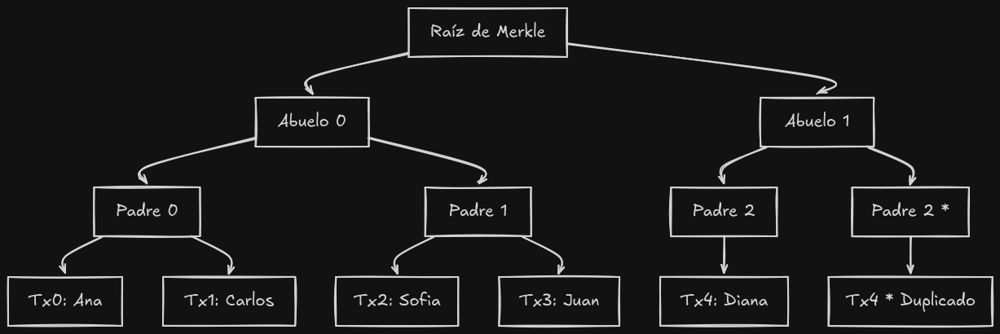
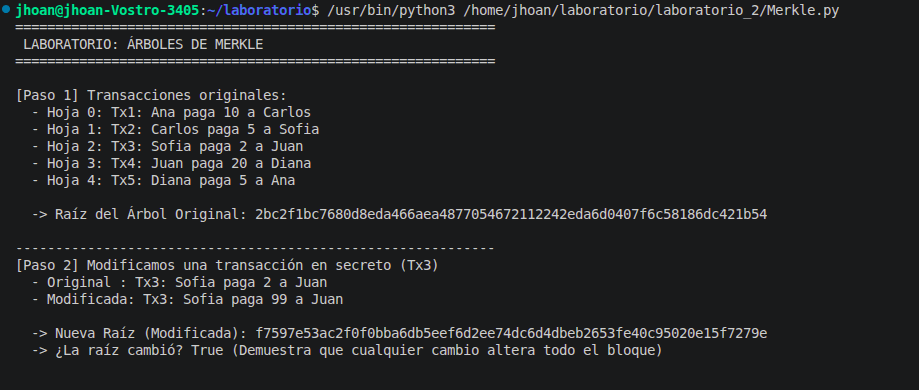
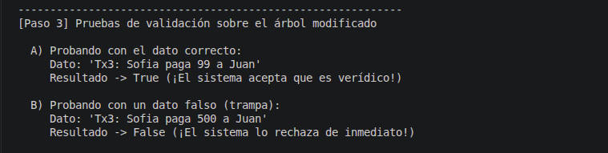

# Laboratorio 2

## Estructuras de datos y laboratorio

**Hecho por:** Jhoan Sebastian Davila Hernandez

---

Este repositorio contiene la solución para el laboratorio de la materia, cumpliendo con las especificaciones y el experimento solicitados.

### Cómo se cumplieron las especificaciones?

Para cumplir con lo pedido, el código se diseñó de la siguiente manera:
* **Hojas con SHA-256:** Cada transacción de texto se procesa individualmente usando el módulo nativo `hashlib` para generar su hash SHA-256 como hoja inicial.
* **Nodos internos:** Para ir subiendo de nivel, el código agrupa los hashes de dos en dos, los concatena y les vuelve a sacar SHA-256.
* **Regla de impares:** Para cumplir con que si el número de hojas o ramas es impar se duplique la última, agregamos una validación lógica que duplica automáticamente el último elemento cuando sobra pareja.
* **Raíz de Merkle (Merkle Root):** Es el hash final que queda en la cima y representa de forma única a todo el conjunto de datos.
---

## Desarrollo del Experimento

El script ejecutable `merkle_lab.py` realiza exactamente lo pedido en el experimento:
1. **5 Transacciones:** Crea un conjunto inicial de 5 transacciones simuladas y construye el árbol mostrando su raíz original.
2. **Modificación:** Modifica una transacción (la Tx3) en secreto y demuestra que al reconstruir el árbol, **la raíz cambia por completo**, evidenciando que cualquier alteración se nota de inmediato.
3. **Prueba de Inclusión (Merkle Proof):** Genera la ruta de verificación para la transacción 3 y prueba dos escenarios:
   * **Con el dato correcto:** Devuelve `True` (el sistema acepta que es verídico).
   * **Con un dato falso/trampa:** Devuelve `False` (el sistema lo rechaza de inmediato).
---

## Diagrama del Árbol Construido

Se muestra en el `README` pero igual esta en la imagen en la carpeta imagenes.

#### Capturas de Pantalla de las Verificaciones

Se les va a dar un vistazo en el `README`, pero igual las capturas estan dentro de la carpeta imagenes.

#### 1. Raíz Original y Cambio al Modificar una Transacción

#### 2. Pruebas de Validación

## Declaración de Uso de Inteligencia Artificial y Código de Honor
En cumplimiento con las normas de conducta académica y el código de honor de la institución, se declara lo siguiente respecto al desarrollo de este laboratorio:
* **Uso de IA:** Se utilizó asistencia de herramientas de Inteligencia Artificial (IA) en el proceso de desarrollo, incluyendo la estructuración de la lógica del código fuente (`merkle_lab.py`), los comentarios explicativos, la documentación del proyecto y el diseño del README.
* **Responsabilidad y Comprensión:** El estudiante declara que ha analizado, ejecutado, validado y comprendido a profundidad cada elemento del código fuente y de la estructura de datos implementada, estando en completa capacidad de explicar su funcionamiento, la lógica de los hashes SHA-256 y la gestión de la regla de impares en caso de ser requerido.

